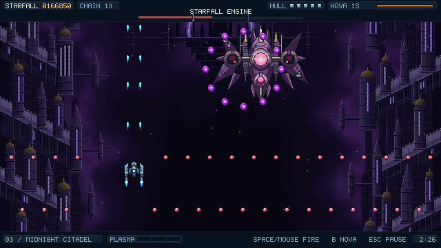

# NGNE Games

A collection of small games built with NGNE. Each game owns its source, assets, tests, configuration, and runtime dependencies under `games/<game-name>/`.

## Games

### Starfall

A full-window arcade shoot-em-up with three sectors, sector bosses, and a rechargeable Nova blast. Requires a WebGPU-capable desktop browser; touch controls are not included.

[](games/starfall/docs/screenshots/midnight-citadel-starfall-engine.png)

[Gameplay and controls](games/starfall/README.md) · [Source](games/starfall/) · [Screenshot provenance](games/starfall/docs/screenshots/README.md)

[Open the gallery](https://that-webdev-dude.github.io/ngne-games/) or [play Starfall](https://that-webdev-dude.github.io/ngne-games/starfall/). This collection is Starfall's deployment home. Build and preview locally with the commands below.

## Requirements

- Node.js 24 or newer
- npm
- A desktop browser with WebGPU support to play Starfall, served over localhost or HTTPS

## Install

```sh
npm ci
```

The collection uses npm workspaces and a single root `package-lock.json`.

## Development and checks

Run these commands from the repository root:

```sh
npm run dev --workspace=starfall -- --port 5173 --strictPort
npm run typecheck
npm test
npm run build
npm run check:campaign
```

To build or preview Starfall independently:

```sh
npm run build --workspace=starfall
npm run preview --workspace=starfall -- --port 4173 --strictPort
```

Game output is in `games/starfall/dist/`. Root `build` typechecks/builds every game, then assembles the gallery and games into root `dist/`. Root `test` runs site-tooling checks and all game suites. `check:campaign` runs Starfall seeds 17, 41, and 83 and fails unless all three clear every sector without diagnostics. Its ignored output is `.test-output/campaign-bot.json`; it does not verify rendering, audible audio, controllers, or human difficulty. See the [Starfall README](games/starfall/README.md) for gameplay, controls, fixtures, and detailed checks.

To preview the combined artifact:

```sh
npm run build
npm run preview -- --port 4173 --strictPort
```

Open the printed local URL for the gallery, or `/starfall/` on that origin for the game. Production paths are `/ngne-games/` and `/ngne-games/starfall/`; local preview at `/` alone does not verify a repository prefix.

`site/games.json` owns catalog metadata. Play and source links are derived from each game's slug and workspace directory. Build every game first; `npm run build:site` then assembles existing game output without running game builds. Missing inputs, unsafe paths, symlinks/junctions, and non-production files in game builds fail assembly. The gallery has no game runtime and links to each full-window game.

## Repository layout

```text
games/starfall/       Game source, assets, tests, configuration, documentation, legal notices
site/                Static gallery template, stylesheet, and catalog
tooling/             Site assembly, campaign assertions, and tooling tests
docs/                Contributor and deployment guides
.github/workflows/   CI and manual Pages deployment
package-lock.json    The single collection lockfile
```

Each game owns its runtime dependencies and can pin its own published NGNE version. Shared developer tools live at the root. Legal notices and asset provenance are game-specific; Starfall's NGNE notices do not establish a collection-wide license.

## CI and deployment

CI checks pull requests targeting `main` and pushes to `main` or `feature/**`. It installs with `npm ci`, checks formatting, runs tooling/game tests, builds the complete collection, and asserts the three Starfall campaign clears. Failed runs upload scoped logs and any campaign report for seven days.

Pages publication is manual-only and guarded to `main`; pushing or merging does not deploy. See [Deployment](docs/deployment.md) for prerequisites, separate approvals, verification, and rollback. Check workflow results in [GitHub Actions](https://github.com/that-webdev-dude/ngne-games/actions).

See [Adding a game](docs/adding-a-game.md) for the workspace, catalog, storage, legal, and validation contract.

## Formatting

```sh
npm run format:check
npm run format
```

These commands check or format the root package, formatting configuration, root README, game package files and READMEs, gallery sources, site tooling, contributor docs, and workflows. Generated output, dependencies, lockfiles, and local evidence are excluded.
