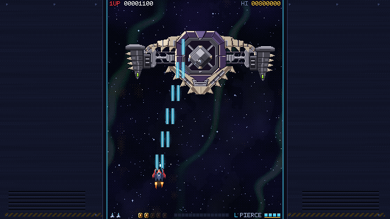
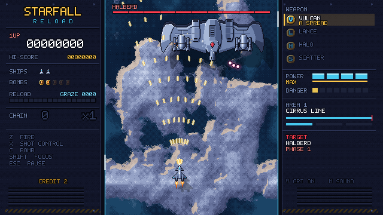
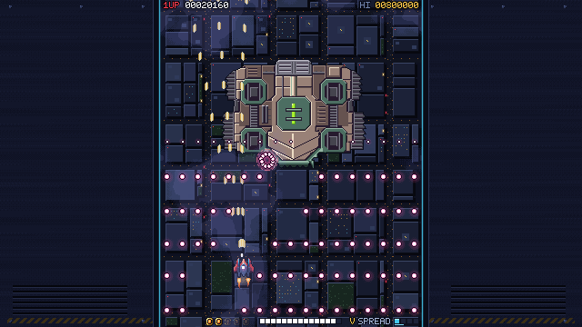

# Starfall Reload

A full-screen vertical arcade shoot-'em-up built with **@ngne/core 0.3.0** and TypeScript. It is an original follow-up to Starfall, with a new cabinet layout, weapons, rules, areas, bosses, art and sound. Requires a WebGPU-capable desktop browser.

[](docs/screenshots/aurora-orbit-seraph-engine.png)

| Cirrus Line · Halberd                                                                                                                                               | Neon Grid · Cantor                                                                                                                                           |
| ------------------------------------------------------------------------------------------------------------------------------------------------------------------- | ------------------------------------------------------------------------------------------------------------------------------------------------------------ |
| [](docs/screenshots/cirrus-line-halberd.png) | [](docs/screenshots/neon-grid-cantor.png) |

The logical view is 640×360: a 288-pixel vertical playfield framed by plain cabinet side panels. A minimal HUD sits in two thin rows inside the playfield: score and hi-score at the top (with the chain multiplier under them while it is live), and ships, bombs, the RELOAD gauge, weapon, Shot Control mode and power at the bottom. It fills the window at an integer scale when that wastes less than 12 % of the screen, otherwise it fits exactly. A CRT treatment (scanlines and vignette) can be toggled with V.

## How it plays

- **Three areas.** Cirrus Line (above a dawn cloud deck), Neon Grid (night megacity with rooftop guns and energy barriers) and Aurora Orbit (debris and mines above the aurora). Each has a mid-boss and a multi-phase boss; the Seraph Engine is the final boss.
- **Four weapon families**, picked up from capsules whose letter cycles: VULCAN, LANCE, HALO and SCATTER. Shot Control switches each between two modes (SPREAD/WING, PIERCE/SEEK, ORBIT/HOLD, BURST/STEER). A capsule matching your weapon adds a power level.
- **Power is armour.** Power runs 0–4. A hit while powered costs two levels and triggers an armour-break pulse; a hit at level 0 destroys the ship. Power chips rebuild it.
- **Graze to reload.** Bullets that pass close to the hitbox fill the RELOAD gauge; a full gauge adds a bomb. Bombs clear bullets and damage everything on screen.
- **Chains.** Kills within 1.25 s of each other build a chain; every eight kills raises the score multiplier, up to x8.
- **Danger.** A hidden rank (0–7) speeds up enemy fire as you power up and progress, and drops when you lose a ship.
- **Credits.** Three ships per credit and three credits. A continue (START on the countdown) or RESTART AREA from the pause menu spends a credit, restarts the current area and resets the score. Extends at 60 000, 200 000 and 500 000. Area bosses that outlast their timer escape without a bonus; the final boss never retreats and must be destroyed.
- **Arcade cabinet flow.** Attract screens with the high-score table and rules, a demo sortie after a short idle, area intro cards, boss WARNING overlays, clear tallies, an ending and three-letter name entry.

## Controls

| Action               | Keyboard            | Standard gamepad    |
| -------------------- | ------------------- | ------------------- |
| Move                 | Arrows or WASD      | Left stick or D-pad |
| Fire (hold)          | Z, J or Space       | A or RT             |
| Shot Control         | X or K              | X or RB             |
| Bomb                 | C or L              | B or Y              |
| Focus (slow, hitbox) | Shift               | LB or LT            |
| Pause / menus        | Escape or P · Enter | Start or Back · A   |
| Fullscreen           | F                   | —                   |
| Sound / CRT          | M / V               | —                   |

Starting from the attract screen with a key or click requests fullscreen. Browsers unlock audio only after a key press or click, so press a key once before playing with a gamepad. The first connected gamepad is used.

## Run

Use Node.js 24 or newer. From the collection root:

```powershell
npm.cmd ci
npm.cmd run build --workspace=starfall-reload
npm.cmd run preview --workspace=starfall-reload -- --port 4173 --strictPort
```

Open **http://127.0.0.1:4173/**. For development, use `npm.cmd run dev --workspace=starfall-reload -- --port 5173 --strictPort`.

Development-only URL parameters (ignored in production builds): `?area=1..3&at=SECONDS&power=0..4&weapon=0..3` starts in an area at a script time, `?pilot=1` lets the demo autopilot fly, and `?timer=1` drives frames from timers for automation panes where `requestAnimationFrame` is paused.

## Checks

```powershell
npm.cmd run test --workspace=starfall-reload
npm.cmd run build --workspace=starfall-reload
```

The tests cover rules (armour, chips, chains, extends, score table, display fit), content consistency, synthesised audio, and a headless campaign: an invulnerable bot clears all three areas with each weapon without a boss escaping, and an idle ship is shot down. The bot proves reachability, not human difficulty or fun.

## Source layout

`src/ecs` holds the NGNE schema components and spawn helpers. `src/sim` is the simulation: player, weapons, enemies, bullets, collisions, rules, the encounter director and `sim/bosses`. `src/game` holds the cabinet flow (attract, continue, tally, ending, name entry) and the demo autopilot. `src/config` owns tuning, weapons, enemy tables and the area scripts. `src/render` draws the procedural atlas effects, font, backdrops, world and HUD. `src/scenes/cabinet.ts` composes everything into one NGNE scene, and `src/services` owns display, audio and storage. High scores and settings are stored under `starfall-reload.*` keys.

## Assets

Sprites in `src/assets/sprites/` were drawn for this game as palette-index grids; their editable sources are in `art/*.px`. The player ship is an NGNE sprite-editor export in `art/` (`player.ngsprite` source, `player.png`, `player.atlas.json`, `player.sprites.ts`) and is drawn from its own texture. Effects, fonts, backdrops and cabinet panels are generated at load. Music and sound effects are original deterministic synthesis (`src/audio/synth.ts`) with no samples. Art direction drew on a study of 1990s arcade shooters; no third-party art, music or code is included.

NGNE is used through the pinned published package. Its MIT licence is reproduced in [LICENSE-NGNE.txt](LICENSE-NGNE.txt).
